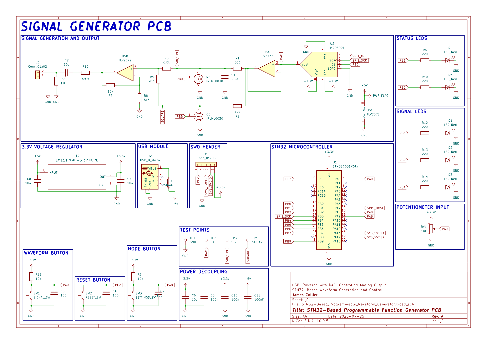
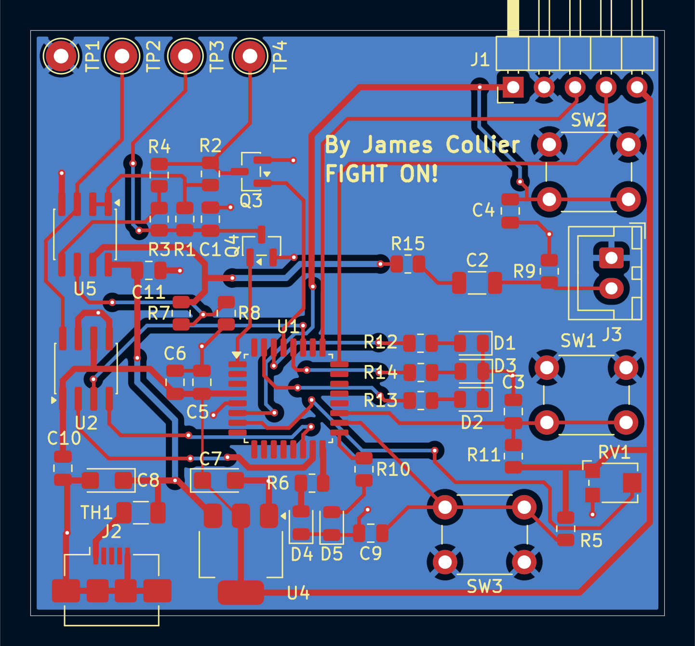
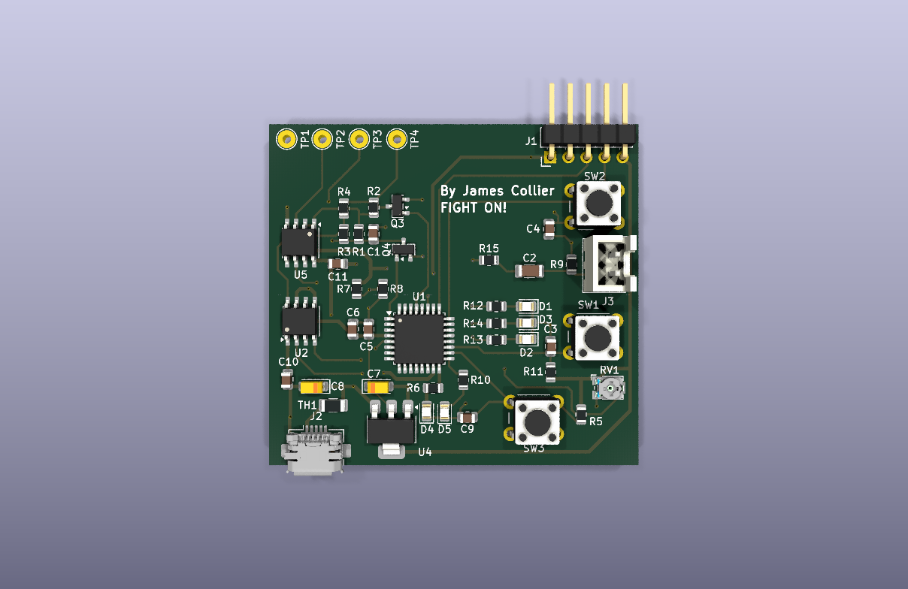

# STM32-Based Programmable Waveform Generator

[](LICENSE)
[](Software/LICENSE)
[](https://www.kicad.org/)

USB-powered programmable function generator built around an STM32C031K6T6 microcontroller and MCP4901 DAC. Generates clean sine, triangle, and square waveforms with amplitude control via potentiometer, mode selection via buttons, and visual feedback through status/signal LEDs.

Designed for lab and bench use with an SWD programming header, multiple test points, and robust power protection.

## Table of Contents
- [Schematic](#schematic)
- [Layout](#layout)
- [3D Model](#3d-model)
- [Overview](#overview)
- [Specifications](#specifications)
- [Results](#results)
- [Software](#software)
- [Tech Stack](#tech-stack)
- [Equipment](#equipment)
- [Manufacturing](#manufacturing)
- [Repository Structure](#repository-structure)
- [Contact](#contact)
- [License](#license)

## Schematic
[](Docs/Images/STM32-Based_Programmable_Waveform_Generator_Schematic.pdf)

## Layout


## 3D Model


## Overview

The board is a compact USB-powered waveform generator centred on an STM32C031K6T6 microcontroller.

| Section                         | Description                                                                                                            |
| ---                             | ---                                                                                                                    |
| **Digital Core**                | The STM32 generates waveform data and drives an MCP4901 8-bit SPI DAC.                                                 |
| **Analog Front-End**            | A TLV2372 dual op-amp and discrete MOSFET switching produce clean sine, triangle, and square outputs.                  |
| **User Interface**              | Three tactile switches provide waveform selection, mode/settings control, and reset. Five status/signal LEDs provide visual feedback, while a potentiometer controls amplitude. |
| **Power**                       | A USB Micro-B input supplies the board through an LM1117 3.3 V regulator with polyfuse protection.                     |

## Specifications

| Parameter                         | Value                                  |
| --------------------------------- | -------------------------------------- |
| **Microcontroller**               | STM32C031K6T6                          |
| **DAC**                           | MCP4901, 8-bit SPI                     |
| **Waveforms**                     | Sine, triangle, and square             |
| **Sine/Triangle Frequency Range** | 1 Hz–50 kHz                            |
| **Square-Wave Frequency Range**   | 1 Hz–100 kHz                           |
| **Amplitude**                     | 0–3.0 Vpp, controlled by potentiometer |
| **Output Impedance**              | ~50 Ω                                  |
| **Power Input**                   | 5 V USB                                |
| **Typical Current**               | 28 mA                                  |
| **Maximum Current**               | 45 mA                                  |
| **Regulation**                    | 3.3 V ± 1.5%                           |
| **Board size**                    | 52 mm × 48 mm                          |

## Results

PCB measurements from the hand-soldered prototype:

| Waveform     | Frequency | Amplitude | THD / Rise-Fall | Notes                           |
| -----------: | --------: | --------: | --------------: | ------------------------------: |
| **Sine**     | 1 kHz     | 2.98 Vpp  | 0.72% THD       | Clean across the full range     |
| **Triangle** | 1 kHz     | 2.95 Vpp  | —               | Linear slope confirmed          |
| **Square**   | 10 kHz    | 3.01 Vpp  | 12 ns / 14 ns   | Fast edges with minimal ringing |

Frequency response, amplitude accuracy (±1.2%), and load regulation were verified using an Agilent Technologies InfiniiVision MSO-X 3034A and Digilent Analog Discovery 3.

## Software

The firmware targets the STM32C031K6T6 and is written in C.

### Programming

1. Create a new STM32CubeIDE project targeting the STM32C031K6T6.
2. Replace the generated `Core/Src/main.c` with [`Software/main.c`](Software/main.c).
3. Configure the required GPIO, SPI, ADC, and timer peripherals.
4. Connect an ST-Link/V2 to the SWD header.
5. Build and flash the firmware through SWD.

## Tech Stack

| PCB Design | Firmware Development | Version Control | Repository Hosting | Circuit Simulation | IDE         | Language |
| :--------: | :------------------: | :-------------: | :----------------: | :----------------: | :---------: | :------: |
|  |  |  |  |  |  |  |

## Equipment

| Tool                   | Model                                          | Purpose |
| ---------------------- | ---------------------------------------------- | ------- |
| **Oscilloscope**       | Agilent Technologies InfiniiVision MSO-X 3034A | Waveform capture, THD, and rise/fall-time measurements |
| **Mixed-signal tool**  | Digilent Analog Discovery 3                    | Frequency-response and spectrum analysis               |
| **Multimeter**         | Tektronix DMM4020A                             | DC accuracy and current-draw measurements              |
| **Programmer**         | ST-Link/V2                                     | Firmware flashing and SWD debugging                    |
| **USB Power Analyzer** | —                                              | Input-current and efficiency verification              |
| **Soldering station**  | —                                              | Hand assembly of all SMD and through-hole components   |

## Manufacturing

Production files are provided in the [`Manufacturing`](Manufacturing/) directory:

| File | Purpose |
| ---- | ------- |
| [`JLCPCB/Waveform_Generator_Gerbers.zip`](Manufacturing/JLCPCB/Waveform_Generator_Gerbers.zip) | Gerber and drill archive, ready to upload to JLCPCB |
| [`JLCPCB/Waveform_Generator_JLCPCB_BOM.csv`](Manufacturing/JLCPCB/Waveform_Generator_JLCPCB_BOM.csv) | Bill of materials with LCSC part numbers (JLCPCB format) |
| [`JLCPCB/Waveform_Generator_JLCPCB_CPL.csv`](Manufacturing/JLCPCB/Waveform_Generator_JLCPCB_CPL.csv) | Component placement list (JLCPCB format) |
| [`Gerbers`](Manufacturing/Gerbers/) | Individual Gerber (copper, mask, silkscreen, paste, outline) and Excellon drill files |
| [`Assembly/STM32-Based_Programmable_Waveform_Generator-all-pos.csv`](Manufacturing/Assembly/STM32-Based_Programmable_Waveform_Generator-all-pos.csv) | KiCad component position file (generic pick-and-place) |

### Ordering from JLCPCB

1. Upload `Waveform_Generator_Gerbers.zip` (2-layer, 52 mm × 48 mm).
2. Enable PCB Assembly, then upload `Waveform_Generator_JLCPCB_BOM.csv` and `Waveform_Generator_JLCPCB_CPL.csv`.
3. Check component rotation and polarity in the JLCPCB placement preview, especially U1, U2, U4, U5, Q3, Q4, D1–D5, and the tantalum capacitors C7 and C8.

> **Note:** At the time of writing, U1 (STM32C031K6T6, LCSC C5456169) and J2 (Amphenol 10104110-0001LF, LCSC C2931352) are stocked by LCSC but not held in JLCPCB's assembly inventory. Pre-order them into your JLCPCB parts library before placing the assembly order. TP1–TP4 are bare test pads and are not assembled.

Verify all fabrication outputs against the KiCad design before ordering.

## Repository Structure

```text
STM32-Based_Programmable_Waveform_Generator
├── .gitignore                                                                  Git ignore rules for KiCad and OS temporary files
├── Docs                                                                        Documentation
│   └── Images                                                                  Board render, layout, and schematic images
│       ├── STM32-Based_Programmable_Waveform_Generator_3D_Model.png            3D render of the board
│       ├── STM32-Based_Programmable_Waveform_Generator_Schematic_Layout.png    PCB layout
│       ├── STM32-Based_Programmable_Waveform_Generator_Schematic.png           Schematic (PNG)
│       └── STM32-Based_Programmable_Waveform_Generator_Schematic.pdf           Schematic (PDF)
├── Hardware                                                                    Hardware design files
│   └── KiCad_Files                                                             KiCad project, schematic, PCB, and project libraries
│       ├── 3D_Models                                                           STEP models used in the 3D render
│       │   ├── LM1117IMP-3-3-NOPB.stp                                          LM1117IMP-3.3/NOPB linear voltage regulator
│       │   ├── TC33X-2-XXX.stp                                                 Bourns TC33X-2-103E potentiometer
│       │   └── USB-B-Micro.stp                                                 USB Micro-B receptacle
│       ├── Footprints                                                          Project footprint library
│       │   └── LM1117.pretty                                                   LM1117 footprints
│       │       ├── DCY0004A_L.kicad_mod
│       │       ├── DCY0004A_M.kicad_mod
│       │       └── DCY0004A_N.kicad_mod
│       ├── Symbols                                                             Project symbol library
│       │   └── LM1117
│       │       └── LM1117.kicad_sym                                            LM1117 linear voltage regulator symbol
│       ├── STM32-Based_Programmable_Waveform_Generator.kicad_pcb               KiCad PCB file
│       ├── STM32-Based_Programmable_Waveform_Generator.kicad_pro               KiCad project file
│       ├── STM32-Based_Programmable_Waveform_Generator.kicad_sch               KiCad schematic file
│       └── sym-lib-table                                                       Project symbol library table
├── Manufacturing                                                               Fabrication and assembly outputs
│   ├── Assembly                                                                Generic assembly data
│   │   └── STM32-Based_Programmable_Waveform_Generator-all-pos.csv             KiCad component position file
│   ├── Gerbers                                                                 Individual Gerber and drill files
│   │   ├── STM32-Based_Programmable_Waveform_Generator-B_Cu.gbl                Bottom copper
│   │   ├── STM32-Based_Programmable_Waveform_Generator-B_Mask.gbs              Bottom solder mask
│   │   ├── STM32-Based_Programmable_Waveform_Generator-B_Paste.gbp             Bottom paste
│   │   ├── STM32-Based_Programmable_Waveform_Generator-B_Silkscreen.gbo        Bottom silkscreen
│   │   ├── STM32-Based_Programmable_Waveform_Generator-Edge_Cuts.gm1           Board outline
│   │   ├── STM32-Based_Programmable_Waveform_Generator-F_Cu.gtl                Top copper
│   │   ├── STM32-Based_Programmable_Waveform_Generator-F_Mask.gts              Top solder mask
│   │   ├── STM32-Based_Programmable_Waveform_Generator-F_Paste.gtp             Top paste
│   │   ├── STM32-Based_Programmable_Waveform_Generator-F_Silkscreen.gto        Top silkscreen
│   │   ├── STM32-Based_Programmable_Waveform_Generator-NPTH.drl                Non-plated drill file
│   │   └── STM32-Based_Programmable_Waveform_Generator-PTH.drl                 Plated drill file
│   └── JLCPCB                                                                  Files ready to upload to JLCPCB
│       ├── Waveform_Generator_Gerbers.zip                                      Gerber and drill archive
│       ├── Waveform_Generator_JLCPCB_BOM.csv                                   Bill of materials with LCSC part numbers
│       └── Waveform_Generator_JLCPCB_CPL.csv                                   Component placement list
├── Software                                                                    Firmware
│   ├── LICENSE                                                                 MIT License for firmware
│   └── main.c                                                                  Firmware for the STM32C031K6T6
├── LICENSE                                                                     CERN Open Hardware Licence Version 2 – Permissive for hardware
└── README.md                                                                   Project README
```

## Contact
- GitHub: [@devjamescollier](https://github.com/devjamescollier)
- Email: [jwcollie@usc.edu](mailto:jwcollie@usc.edu)

## License

Copyright © 2026 James Collier

The hardware design files are licensed under the CERN Open Hardware
Licence Version 2 – Permissive. See [LICENSE](LICENSE).

The firmware is licensed under the MIT License. See
[Software/LICENSE](Software/LICENSE).